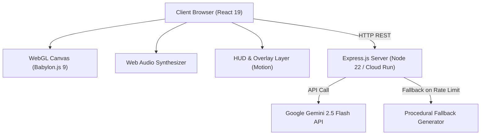

# Architecture & Technical Design

This document details the architectural design, rendering pipelines, physics simulation models, state machines, and server architecture of the **curtis.click Portfolio**.

---

## 1. High-Level Architecture Overview

---

## 2. Frontend Subsystems

### 2.1 React 19 UI & Navigation Layer
- **[`src/App.tsx`](file:///home/corp/curtis-click-portfolio/src/App.tsx)**: Central application state manager. Tracks scroll progress through 6 stages (`SINGULARITY`, `SELECTED WORKS`, `AI ENGINEERING`, `AUTONOMY`, `ALIGNMENT`, `SYNTHESIS`), autopilot mode, interstellar sandbox mode, active target locks, and global hotkeys (`[A]` Autopilot, `[C]` Cinematic Mode, `[W]` Wormhole, `[N]` Supernova, `[P]` Slingshot Probe, `[T]` TDE, `[M]` Audio Mute Toggle, `[Escape]` Exit Cinema / Autopilot / Overlays). Standard `keydown` listener ensures modern W3C compliance and responsive idle resets across all key actions.
- **[`src/components/InterstellarHUD.tsx`](file:///home/corp/curtis-click-portfolio/src/components/InterstellarHUD.tsx)**: Futuristic telemetry overlay displaying system coordinates, orbital metrics, spacetime curvature indicators, and active celestial body metadata.
- **[`src/components/ProjectHUD.tsx`](file:///home/corp/curtis-click-portfolio/src/components/ProjectHUD.tsx)**: Stage-based portfolio project cards with motion transitions.
- **[`src/components/DebugInspectorCard.tsx`](file:///home/corp/curtis-click-portfolio/src/components/DebugInspectorCard.tsx)**: Interactive diagnostics drawer for particle velocity multipliers, layer visibility toggles, and runtime telemetry.

### 2.2 3D Astrophysics & Rendering Engine ([`src/components/ParticleCanvas/`](file:///home/corp/curtis-click-portfolio/src/components/ParticleCanvas/))
- **[`SceneSetup.ts`](file:///home/corp/curtis-click-portfolio/src/components/ParticleCanvas/SceneSetup.ts)**: Initializes Babylon.js `Engine`, `Scene`, `TargetCamera`, and default rendering pipeline (Bloom, Tone Mapping, Chromatic Aberration).
- **[`CelestialMeshSynchronizer.ts`](file:///home/corp/curtis-click-portfolio/src/components/ParticleCanvas/CelestialMeshSynchronizer.ts)**: Synchronizes simulated 2D/3D `CelestialEntity` objects with Babylon.js mesh instances (PBR materials, Fresnel glow layers, dynamic lighting, rings). Features `getSpacetimeFabricDistortion` with defensive coordinate barriers against non-finite inputs, zero dimensions, and null entity/ripple lists, as well as strict SSR guards protecting global window flags (`__cinematicMode`, `__screensaverManaged`).
- **[`RenderEngine.ts`](file:///home/corp/curtis-click-portfolio/src/components/ParticleCanvas/RenderEngine.ts)**: Main animation loop executing 60 FPS delta-time physics updates, camera shake dampening, slingshot probe updates, and particle velocity fields. Universal runtime guards (`typeof window !== "undefined"`) ensure seamless execution across client browsers, headless Node.js tests, and SSR environments.
- **[`PhysicsUtils.ts`](file:///home/corp/curtis-click-portfolio/src/components/ParticleCanvas/PhysicsUtils.ts) & [`CollisionEngine.ts`](file:///home/corp/curtis-click-portfolio/src/components/ParticleCanvas/CollisionEngine.ts)**:
  - Conservation of Momentum & Energy elastic/inelastic collision solver with overlap resolution.
  - Defensive non-finite and NaN coordinate rejection (`isNaN(dist) || !isFinite(dist) || dist <= 0.0001 || e1.radius <= 0 || e2.radius <= 0`) and positive mass validation preventing division-by-zero or physics state corruption.
  - Accretion and swallowing of bodies into black holes (`swallowEntity`) with strict positive finite fallbacks for masses and radii.
  - Spawns incandescent 3D collision flares (`spawnCollisionFlare`) and high-velocity shatter debris (`createShatterDebris`) upon violent celestial body impacts. Flare spawning enforces safe positive radii, finite coordinates, scene validity, and bounds active flares (max 50) by cleanly disposing the oldest when capacity is exceeded to eliminate WebGL memory leaks.
  - Unified flare lifecycle management (`updateCollisionFlares`) with safe WebGL material disposal and scaling decay.
  - Procedural Value Noise and Fractional Brownian Motion (fBm) 2D/3D noise algorithms with defensive barriers against non-finite inputs and octave bounds capping.
  - Zero-divergence Curl Noise vector fields for natural fluid interstellar gas motion with strict zero-vector fallbacks on non-finite coordinates or time.
  - Hex color normalization and blending with shorthand 3-digit hex code expansion.
- **[`SlingshotEngine.ts`](file:///home/corp/curtis-click-portfolio/src/components/ParticleCanvas/SlingshotEngine.ts)**:
  - Solves Runge-Kutta / Euler n-body gravitational trajectory forecasts for interactive probe launches.
  - Defensive non-finite coordinate barriers (`!isFinite(originX) || !isFinite(originY) || !isFinite(pullX) || !isFinite(pullY) || !isFinite(initialVz) || steps <= 0`) returning safe empty trajectories, automatic filtering of entities with non-finite coordinates, non-array entities fallback, and zero-pull distance handling.
  - Active probe trajectory and physics updates (`updateActiveProbes`) with strict finite value enforcement discarding corrupt probes, defensive ripples array validation, and periapsis whip boost triggers.
  - Deterministic forward trajectory calculation eliminating aim preview depth-jitter.
  - Scale-aware celestial gravitation that safely ignores zero-scale (`scale <= 0.01`) or despawning bodies to prevent unnatural trajectory snaps.
  - Event horizon capture detection (`isHorizonBound`) and sub-lightspeed ceiling (55.0).
- **[`HawkingRadiationEngine.ts`](file:///home/corp/curtis-click-portfolio/src/components/ParticleCanvas/HawkingRadiationEngine.ts)**:
  - Manages subtle 3D quantum Hawking radiation particle systems emanating from black hole event horizon cores with scale-aware Schwarzschild emitter radius (`rs = baseRad * scale * 0.95`).
  - Universal runtime guards and fallback texture allocation enabling seamless instantiation and lifecycle testing in headless / SSR environments.
  - Defensive math barriers in `update` protecting against non-finite or negative proximity and delta time inputs, preventing NaN emission rates.
- **[`TextureUtils.ts`](file:///home/corp/curtis-click-portfolio/src/components/ParticleCanvas/TextureUtils.ts)**:
  - Procedural dynamic texture generators for celestial surfaces, accretion disks, photon rings, relativistic jets, night lights, bump normals, clouds, auroras, star surfaces, concentric rings, lightwaves, galaxies, nebulae, and supernova cataclysms.
  - Universal `isCanvasSupported()` runtime guards returning safe headless fallback textures across all 18 generators, guaranteeing robust SSR and Node.js testing execution.
- **[`ParticleCanvasEvents.ts`](file:///home/corp/curtis-click-portfolio/src/components/ParticleCanvas/ParticleCanvasEvents.ts)**:
  - Centralized event orchestration for viewport resizing, mouse/touch dragging, slingshot aiming, horizon zoom, and global hotkeys. Keyboard interactions actively reset idle activity timers.
  - Universal SSR safety barrier (`typeof window === "undefined"`) preventing ReferenceErrors in headless test and server runtimes.
  - Race condition prevention on asynchronous `DeviceOrientationEvent.requestPermission()` ensuring no orphaned event listeners are registered after component teardown.
  - Defensive array guards on `ripplesRef` preventing runtime TypeErrors during intense user interactions.
- **[`TidalDisruptionEngine.ts`](file:///home/corp/curtis-click-portfolio/src/components/ParticleCanvas/TidalDisruptionEngine.ts) & [`TidalDisruptionFX.ts`](file:///home/corp/curtis-click-portfolio/src/components/ParticleCanvas/TidalDisruptionFX.ts)**:
  - Multi-phase state machine: `IDLE` -> `STAR_APPROACH` -> `ROCHE_RUPTURE` -> `ACCRETION_SURGE` -> `GRB_DETONATION` -> `COOLDOWN`.
  - Roche-limit calculation where stars entering a black hole's tidal radius are shredded into accretion streams and relativistic plasma jets.
  - Dimension boundary safeguards defending against non-finite, zero, or negative viewport dimensions during simulation updates.
  - Progression safeguards ensuring smooth transitions to `ACCRETION_SURGE` upon stellar core mass depletion, with bounded particle streamer management (max 400).
  - Strict particle sanitization purging any corrupt streamers or fragments with non-finite coordinates or negative radii, and defensive array/reference guards on `ripplesRef` and `cameraShakeRef`.
- **[`ParticleCanvas.tsx`](file:///home/corp/curtis-click-portfolio/src/components/ParticleCanvas.tsx) Resource Lifecycle Management**:
  - Enforces strict teardown order upon component unmount:
    1. Clear active timeouts, interval timers, and debounced resize listeners (`clearTimeout(resizeTimeout)`).
    2. Detach event listeners and remove pointer observers.
    3. Dispose all celestial mesh subsystems (e.g., active `hawkingSystem` quantum particle emitters and parent mesh materials/textures).
    4. Dispose active post-processes and custom FX (`lensingPostProcessRef`, `wormholePostProcessRef`, `dofPostProcessRef`, `shatterPostProcessRef`, `activeTdeFxRef`, `activeSupernovaFxRef`).
    5. Dispose `glowLayerRef`, `hudTextureRef`, and `hudPlaneRef`.
    6. Dispose rendering pipeline (`composerRef`).
    7. Dispose the Babylon scene (`sceneRef`).
    8. Stop render loop and dispose the Babylon Engine (`rendererRef`) last.
    9. Clean up all attached global window properties (`__horizonZoom`, `__shatterIntensity`, `__hasShatteredSound`, `__forcedNextArchetype`, `__hawkingActive`, `__hawkingIntensity`).

### 2.3 Post-Processing GLSL Shaders
- **[`BlackholeLensingPostProcess.ts`](file:///home/corp/curtis-click-portfolio/src/components/ParticleCanvas/BlackholeLensingPostProcess.ts)**: General relativistic deflection shader warping background space into Einstein rings around Kerr singularities.
- **[`DepthOfFieldPostProcess.ts`](file:///home/corp/curtis-click-portfolio/src/components/ParticleCanvas/DepthOfFieldPostProcess.ts)**: Bokeh depth-of-field post-processing focusing on active target entities.
- **[`FrameShatterPostProcess.ts`](file:///home/corp/curtis-click-portfolio/src/components/ParticleCanvas/FrameShatterPostProcess.ts)**: 13x13 Voronoi crystalline shatter shader triggered by stellar core collapse events.

---

## 3. Server Architecture ([`server.ts`](file:///home/corp/curtis-click-portfolio/server.ts))

- **Dual-Mode Serving**:
  - **Development (`NODE_ENV !== 'production'`)**: Dynamically mounts Vite middleware with live reload.
  - **Production (`NODE_ENV === 'production'`)**: Serves pre-compiled production bundles from `dist/` with single-page app (SPA) HTML fallback.
- **Gemini Cosmic System Generation**:
  - Lazily initializes `@google/genai` client using `GEMINI_API_KEY`.
  - Configurable model via `GEMINI_MODEL` (defaults to `gemini-2.5-flash`).
  - Supports client-requested archetype overrides and themes in the POST payload.
  - Archetype validation and sanitization guaranteeing that model outputs conform strictly to one of the 6 recognized core archetypes (`BLACKHOLE_CENTRIC`, `BINARY_PLANETS`, `NEBULA_CRADLE`, `EXOPLANET_CLUSTER`, `SPIRAL_GALAXY`, `STELLAR_PULSAR`).
  - Automatic fallback to `getProceduralFallbackSystem(requestedArchetype)` on network errors or rate limits (`429`).
- **Container Health Probes**:
  - `GET /health` and `GET /api/health` return service status, environment (`NODE_ENV`), configured Gemini model (`GEMINI_MODEL`), ISO timestamp, process uptime, Node.js runtime version, and memory usage metrics (`rss`, `heapTotal`, `heapUsed`).
  - Dedicated `ALL /api/*` 404 handler prevents missing API routes from inadvertently returning HTML.
- **Telemetry Ingestion & Bounded Logging**:
  - `POST /api/log-error` handles both string, text/plain beacon, and structured JSON error objects, sanitizing payloads (500 character ceiling) and rotating/truncating `client_errors.log` if size exceeds 1MB, ensuring storage stability.
  - Client-side telemetry suppression filters out browser extension anomalies (`chrome-extension://`, `moz-extension://`, `safari-extension://`, `safari-web-extension://`, `ms-browser-extension://`) and benign layout warnings (`ResizeObserver loop completed with undelivered notifications`, `ResizeObserver loop limit exceeded`).
- **Body-Parser & JSON API Error Middleware**:
  - Dedicated Express error-handling middleware (`(err, req, res, next)`) that intercepts body parser syntax errors (malformed JSON) and unhandled API exceptions, returning structured `{ error: "Invalid JSON payload" }` with HTTP 400 instead of Express default HTML stack traces.
- **Port Conflict & Ephemeral Port Handling**:
  - Supports explicit `PORT=0` for dynamic free port allocation by the OS kernel, alongside resilient `EADDRINUSE` collision handling with actionable remediation diagnostics.
- **Graceful Shutdown**:
  - Handles `SIGTERM` and `SIGINT` signals with a 10-second drain timeout for zero-downtime rolling deployments on Cloud Run and Kubernetes, with clean listener deregistration upon server close.

---

## 4. Verification & Testing ([`scripts/test-integrity.ts`](file:///home/corp/curtis-click-portfolio/scripts/test-integrity.ts))

The project includes an automated 63-test integrity test suite verifying:
1. **Hex Color Utilities**: 6-digit hex preservation, 3-digit shorthand expansion (`#fff` -> `#ffffff`), and NaN-free blending.
2. **Physics & Noise Calculations**: `valueNoise2D` bounds, `fBmNoise2D` octave aggregation and negative octave safety, `computeCurlNoise` vector output and zero-vector guards against non-finite inputs, `resolveCelestialCollision` momentum conservation, and defensive rejection of non-finite/NaN coordinates, zero separation, and negative radii.
3. **Collision Flares & Spacetime Distortion**: `spawnCollisionFlare` safe radius and coordinate enforcement, capacity bounding (max 50) with oldest flare material disposal, and `getSpacetimeFabricDistortion` defensive math barriers against non-finite inputs and null references.
4. **Procedural Cosmic Systems**: Schema validation across 70 iterations covering all 6 archetypes, and contract conformance across all 6 procedural scene builders.
5. **Astrophysics Events & Engine Simulation**:
   - `createNeutronStarBirthEvent`: remnant mass safety and non-positive/NaN mass fallbacks.
   - `calculateForwardTrajectory`: determinism, sub-lightspeed ceiling (55.0), zero-scale entity filtering, non-finite origin rejection, non-array entities fallback, and zero-pull distance handling.
   - `updateActiveProbes`: relativistic clamping, finite coordinate validation, null probe/entity/ripple safety guards, and slingshot boost triggers.
   - `TidalDisruptionEngine`: quiescent state, hyperbolic approach, dimension boundary safeguards, mass-depleted progression safeguards, non-finite particle filtering, and null ripplesRef/cameraShakeRef guards.
   - `RenderEngine`: headless execution safety of `executeRenderFrame` in SSR and Node.js test environments without `window` reference errors.
   - `HawkingRadiationEngine`: headless lifecycle execution in Babylon NullEngine, defensive non-finite proximity and dt bounds handling, and scale-aware Schwarzschild emitter geometry.
   - `TextureUtils`: universal headless / SSR fallback dynamic textures across all 18 texture generators.
   - `ParticleCanvasEvents`: headless SSR execution safety, listener cleanup, and race-free device orientation permission handling.
6. **Audio Engine & State Machine**: Volume/time-dilation modulation bounds (including NaN/Infinity clamping), mute toggles (`getMuteState`/`setMute`), bus teardown and garbage collection upon disposal, and `CosmicTransitionStateMachine` lifecycle transitions and cancellation.
7. **SSR Resilience & Post-Processing Shaders**:
   - SSR guards for `particleText`, `drawStageLayoutTemplate`, `generateTargetsForStage` (safe array returns without `undefined` leaks for arbitrary stage indices), `HUDManager` texture updates with null or disposed meshes, and `triggerCalmCosmicShift`.
   - Post-processing shader instantiation and uniform application safety (`setupBlackholeLensingPostProcess`, `setupDepthOfFieldPostProcess`, `setupFrameShatterPostProcess`) with defensive runtime checks.
   - `WormholeTransit` parameter verification and non-blocking state safety.
8. **Static Assets & Bundle Readiness**:
   - `favicon.svg`, `index.html` metadata, and chunk outputs (`babylon-*.js`, `vendor-*.js`, `index-*.js`, `server.cjs`).
   - Vite 6 chunking rules ensuring `framer-motion`, `motion`, `react`, `react-dom`, and `lucide-react` cleanly bundle into `vendor-*.js` to minimize `index-*.js`.
   - Browser extension error filtering (`chrome-extension://`, `moz-extension://`, `safari-extension://`, `safari-web-extension://`, `ms-browser-extension://`), duplicate deduplication, and rate limiting.
   - UI element classification (`isUIElement`) and hotkey mapping set (`[A]`, `[C]`, `[W]`, `[N]`, `[T]`, `[P]`, `[M]`, `[Escape]`).
9. **Server Endpoints & Integration**: `/health`, `/api/health`, `/api/generate-cosmic-scene` with archetype overrides, `ALL /api/*` 404 handler, structured `/api/log-error` with log rotation, plain text beacon handling, malformed JSON body-parser 400 interception, `PORT=0` ephemeral binding, `EADDRINUSE` port conflict handling, and clean process listener deregistration.
