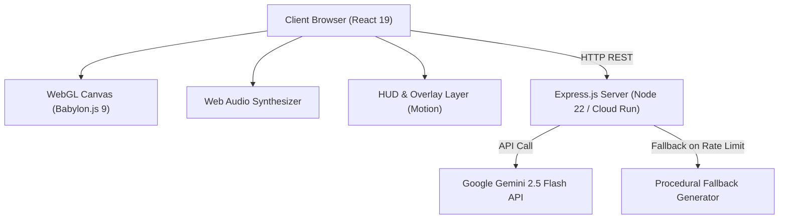

# Architecture & Technical Design

This document details the architectural design, rendering pipelines, physics simulation models, state machines, and server architecture of the **curtis.click Portfolio**.

---

## 1. High-Level Architecture Overview

---

## 2. Frontend Subsystems

### 2.1 React 19 UI & Navigation Layer
- **[`src/App.tsx`](file:///home/corp/curtis-click-portfolio/src/App.tsx)**: Central application state manager. Tracks scroll progress through 6 stages (`SINGULARITY`, `SELECTED WORKS`, `AI ENGINEERING`, `AUTONOMY`, `ALIGNMENT`, `SYNTHESIS`), autopilot mode, interstellar sandbox mode, active target locks, and global hotkeys (`[A]` Autopilot, `[C]` Cinematic Mode, `[W]` Wormhole, `[N]` Supernova, `[P]` Slingshot Probe, `[T]` TDE, `[M]` Audio Mute Toggle, `[Escape]` Exit Cinema / Autopilot / Overlays). Standard `keydown` listener ensures modern W3C compliance and responsive idle resets across all key actions.
- **[`src/components/InterstellarHUD.tsx`](file:///home/corp/curtis-click-portfolio/src/components/InterstellarHUD.tsx)**: Futuristic telemetry overlay displaying system coordinates, orbital metrics, spacetime curvature indicators, and active celestial body metadata.
- **[`src/components/ProjectHUD.tsx`](file:///home/corp/curtis-click-portfolio/src/components/ProjectHUD.tsx)**: Stage-based portfolio project cards with motion transitions.
- **[`src/components/DebugInspectorCard.tsx`](file:///home/corp/curtis-click-portfolio/src/components/DebugInspectorCard.tsx)**: Interactive diagnostics drawer for particle velocity multipliers, layer visibility toggles, and runtime telemetry.

### 2.2 3D Astrophysics & Rendering Engine ([`src/components/ParticleCanvas/`](file:///home/corp/curtis-click-portfolio/src/components/ParticleCanvas/))
- **[`SceneSetup.ts`](file:///home/corp/curtis-click-portfolio/src/components/ParticleCanvas/SceneSetup.ts)**: Initializes Babylon.js `Engine`, `Scene`, `TargetCamera`, and default rendering pipeline (Bloom, Tone Mapping, Chromatic Aberration).
- **[`CelestialMeshSynchronizer.ts`](file:///home/corp/curtis-click-portfolio/src/components/ParticleCanvas/CelestialMeshSynchronizer.ts)**: Synchronizes simulated 2D/3D `CelestialEntity` objects with Babylon.js mesh instances (PBR materials, Fresnel glow layers, dynamic lighting, rings). Features `getSpacetimeFabricDistortion` with defensive coordinate barriers against non-finite inputs, zero dimensions, and null entity/ripple lists, null-safe `celestialEntitiesRef` array validation, defensive audio amplitude and frequency band extraction (`isFinite`) protecting mesh rotation and pulsation matrix calculations from `NaN` corruption, collision flare list capacity bounding (`MAX_ACTIVE_FLARES = 50`) with clean oldest flare/material disposal during black hole devour events, safe coordinate and radius sanitization, as well as strict SSR guards protecting global window flags (`__cinematicMode`, `__screensaverManaged`).
- **[`CelestialMeshBuilder.ts`](file:///home/corp/curtis-click-portfolio/src/components/ParticleCanvas/CelestialMeshBuilder.ts) & 3D Celestial Objects ([`objects/`](file:///home/corp/curtis-click-portfolio/src/components/ParticleCanvas/objects/))**:
  - `blackhole_type1.ts`: 3D Schwarzschild black hole constructor featuring event horizon void sphere, tilted accretion disks, gravitational lensing arches (upper Gargantua crown & lower bent arch), relativistic photon ring, dual polar plasma jets, and magnetic shock diamond pinch nodes. Implements defensive `safeRadius` fallbacks, position coordinate sanitization (`safeWx`, `safeWy`), and `safeScale` clamping preventing zero or `NaN` geometry construction in Babylon.js.
  - `star.ts`: 3D stellar body constructor with glowing photosphere core, Fresnel corona atmosphere, and optional precessing relativistic synchrotron jets and equatorial magnetic radiation belts. Features safe radius fallbacks, position coordinate sanitization, `safeScale` clamping, and null entity protection.
  - `galaxy.ts`: 3D spiral galaxy disk and coronal halo constructor with safe radius clamping, position coordinate sanitization, `safeScale` clamping, and null entity guards.
  - `planet.ts` & `nebula.ts`: Particle-driven celestial representations with clean imports, position coordinate sanitization (`safeWx`, `safeWy`), `safeScale` clamping, and lightweight transform anchors.
- **[`RenderEngine.ts`](file:///home/corp/curtis-click-portfolio/src/components/ParticleCanvas/RenderEngine.ts)**: Main animation loop executing 60 FPS delta-time physics updates, camera shake dampening, slingshot probe updates, and particle velocity fields. Universal runtime guards (`typeof window !== "undefined"`), default input controller fallbacks defending against undefined controller references, positive viewport bounds sanitization, defensive audio amplitude/frequency band extraction with `isFinite` fallbacks preventing `NaN` corruption of smoothed audio references, and defensive sanitization of delta-time and clock dilation against non-finite or `NaN` values ensure seamless execution across client browsers, headless Node.js tests, and SSR environments.
- **[`SupernovaFX.ts`](file:///home/corp/curtis-click-portfolio/src/components/ParticleCanvas/SupernovaFX.ts)**: High-density 3D stellar core collapse and supernova cataclysm generator featuring dynamic PointLight illumination, custom Fresnel shockwave bubbles, GPU burst particle systems, and dual polar relativistic plasma jets. Employs defensive barriers against null or disposed scenes (returning safe no-op instances), finite position fallbacks (`safePos = worldPos ? worldPos.clone() : new Vector3(0, 0, 0)` universally propagated to all particle emitters, polar dummy meshes, and jet dummies to prevent unhandled `clone()` TypeErrors), volumetric light scattering headless runtime protection, and automatic disposal upon lifecycle duration completion.
- **[`PostProcess Shaders`](file:///home/corp/curtis-click-portfolio/src/components/ParticleCanvas/)**:
  - `BlackholeLensingPostProcess.ts`: Schwarzschild relativistic deflection, Einstein ring warping, photon sphere amplification, and anamorphic flare streaks. Implements defensive barriers against null camera, disposed scene, null engine, and non-array `celestialEntitiesRef.current` fallbacks during uniform application in `onApply`.
  - `DepthOfFieldPostProcess.ts`: Cinematic anamorphic bokeh and circle of confusion (CoC) optical blurring. Incorporates defensive parameter checks against null camera/scene/engine and array guards on `celestialEntitiesRef.current`.
  - `FrameShatterPostProcess.ts`: 13x13 Voronoi crystalline shatter effect. Implements defensive setup guards, non-array entity safety in `onApply`, and finite intensity fallbacks.
- **[`WormholeTransit.ts`](file:///home/corp/curtis-click-portfolio/src/components/ParticleCanvas/WormholeTransit.ts)**: Einstein-Rosen bridge curved throat transit system featuring dynamic camera warping, Cherenkov throat glow, accretion vortex discs, and post-processing swirl shaders. Incorporates defensive teardown resilience ensuring `isTransitActiveRef` and `wormholeIntensityRef` are safely reset to quiescent states even when the Babylon scene is disposed mid-transit.
- **[`PhysicsUtils.ts`](file:///home/corp/curtis-click-portfolio/src/components/ParticleCanvas/PhysicsUtils.ts) & [`CollisionEngine.ts`](file:///home/corp/curtis-click-portfolio/src/components/ParticleCanvas/CollisionEngine.ts)**:
  - Conservation of Momentum & Energy elastic/inelastic collision solver with overlap resolution.
  - Defensive non-finite and NaN coordinate/radius rejection (`isNaN(dist) || !isFinite(dist) || dist <= 0.0001 || !isFinite(e1.radius) || !isFinite(e2.radius) || e1.radius <= 0 || e2.radius <= 0`), sanitized restitution (`safeRestitution` clamped to `[0.0, 1.0]`), null entity safety, and positive mass validation preventing division-by-zero or physics state corruption.
  - Accretion and swallowing of bodies into black holes (`swallowEntity`) with strict positive finite fallbacks for masses and radii, and null entity guards.
  - Spawns incandescent 3D collision flares (`spawnCollisionFlare`) and high-velocity shatter debris (`createShatterDebris`) upon violent celestial body impacts. Flare spawning enforces safe positive radii, finite coordinates, scene validity, and bounds active flares (max 50) by cleanly disposing the oldest when capacity is exceeded to eliminate WebGL memory leaks.
  - Debris and particle generators (`createDustSplash`, `createShatterDebris`, `createSpaghettificationDebris`) defend against null entities, non-positive radii, and non-function spawn callbacks.
  - Unified flare lifecycle management (`updateCollisionFlares`) with safe WebGL material disposal, delta-time sanitization (`safeDt`), non-finite `life` protection, and scaling decay.
  - Procedural Value Noise and Fractional Brownian Motion (fBm) 2D/3D noise algorithms with defensive barriers against non-finite inputs and octave bounds capping.
  - Zero-divergence Curl Noise vector fields for natural fluid interstellar gas motion with strict zero-vector fallbacks on non-finite coordinates or time.
  - Hex color normalization and blending with shorthand 3-digit, 4-digit `#rgba`, and 8-digit `#rrggbbaa` hex code expansion, whitespace/case normalization, and NaN weight protection (`isNaN(weight) ? 0.5 : Math.max(0, Math.min(1, weight))`).
- **[`SlingshotEngine.ts`](file:///home/corp/curtis-click-portfolio/src/components/ParticleCanvas/SlingshotEngine.ts)**:
  - Solves Runge-Kutta / Euler n-body gravitational trajectory forecasts for interactive probe launches.
  - Defensive non-finite coordinate barriers (`!isFinite(originX) || !isFinite(originY) || !isFinite(pullX) || !isFinite(pullY) || !isFinite(initialVz) || steps <= 0`) returning safe empty trajectories, automatic filtering of entities with non-finite coordinates, non-array entities fallback, and zero-pull distance handling.
  - Active probe trajectory and physics updates (`updateActiveProbes`) with strict finite value enforcement discarding corrupt probes, defensive ripples array validation, trail decay protection preventing `NaN` alpha values, probe list capacity bounding (`MAX_ACTIVE_PROBES = 25`) preventing unbounded memory growth, and periapsis whip boost triggers.
  - Deterministic forward trajectory calculation eliminating aim preview depth-jitter.
  - Scale-aware celestial gravitation that safely ignores zero-scale (`scale <= 0.01`) or despawning bodies to prevent unnatural trajectory snaps.
  - Event horizon capture detection (`isHorizonBound`) and sub-lightspeed ceiling (55.0).
- **[`HawkingRadiationEngine.ts`](file:///home/corp/curtis-click-portfolio/src/components/ParticleCanvas/HawkingRadiationEngine.ts)**:
  - Manages subtle 3D quantum Hawking radiation particle systems emanating from black hole event horizon cores with scale-aware Schwarzschild emitter radius (`rs = baseRad * scale * 0.95`).
  - Universal runtime guards and fallback texture allocation enabling seamless instantiation and lifecycle testing in headless / SSR environments.
  - Defensive barriers against null or disposed scenes as well as null parent containers, returning safe no-op instances (`currentIntensity: 0`).
  - Defensive math barriers in `update` protecting against non-finite or negative proximity and delta time inputs, preventing NaN emission rates.
- **[`TextureUtils.ts`](file:///home/corp/curtis-click-portfolio/src/components/ParticleCanvas/TextureUtils.ts)**:
  - Procedural dynamic texture generators for celestial surfaces, accretion disks, photon rings, relativistic jets, night lights, bump normals, clouds, auroras, star surfaces, concentric rings, lightwaves, galaxies, nebulae, and supernova cataclysms.
  - Universal `!scene || scene.isDisposed || !isCanvasSupported()` runtime guards returning safe headless fallback textures across all 18 generators, guaranteeing robust SSR and Node.js testing execution even with null or disposed Babylon scenes.
  - Corrected `parseColorToRgb` zero-channel extraction protecting black (`#000000`) and pure primary hex components from inadvertent white fallbacks (`|| 255`), alongside full 4-digit shorthand `#rgba` hex string parsing and support for named CSS color constants (`black`, `white`, `transparent`).
  - Added safe alpha clamping and decimal alpha string extraction in `parseColorToBabylonColor4` defending against NaN or non-finite transparency values.
- **[`ParticleSimulationEngine.ts`](file:///home/corp/curtis-click-portfolio/src/components/ParticleCanvas/ParticleSimulationEngine.ts)**:
  - Universal 60 FPS particle simulation engine updating position, velocity, and color buffers for up to 10,000 active particles across typography, interstellar, tail, and cosmic ambient clouds.
  - Built-in viewport bounds sanitization guarding `currentW` and `currentH` against non-finite, zero, or negative dimensions to ensure clean particle coordinate centering.
  - Robust context safety with defensive array fallbacks for `activeBlackholes`, `activeCollidables`, `celestialEntities`, `activeRipples`, and complete fallback initialization for `particleFilters` ensuring no unhandled TypeErrors when executing with partial or undefined context.
- **[`ParticleCanvasEvents.ts`](file:///home/corp/curtis-click-portfolio/src/components/ParticleCanvas/ParticleCanvasEvents.ts)**:
  - Centralized event orchestration for viewport resizing, mouse/touch dragging, slingshot aiming, horizon zoom, and global hotkeys. Keyboard interactions actively reset idle activity timers.
  - Interactive UI element classification (`isUIElement`) and hotkey input target exclusion ignoring keystrokes when focused on `<input>`, `<textarea>`, `<select>`, and `[contenteditable]` elements across both `ParticleCanvasEvents.ts` and `CinematicOverlay.tsx`.
  - Universal SSR safety barrier (`typeof window === "undefined"`) preventing ReferenceErrors in headless test and server runtimes.
  - Race condition prevention on asynchronous `DeviceOrientationEvent.requestPermission()` ensuring no orphaned event listeners are registered after component teardown.
  - Defensive array guards on `ripplesRef` preventing runtime TypeErrors during intense user interactions.
  - Optional reference guards on `screensaverOpacityRef` in `resetActivity()` ensuring calls without optional refs do not throw unhandled TypeErrors.
- **[`TidalDisruptionEngine.ts`](file:///home/corp/curtis-click-portfolio/src/components/ParticleCanvas/TidalDisruptionEngine.ts) & [`TidalDisruptionFX.ts`](file:///home/corp/curtis-click-portfolio/src/components/ParticleCanvas/TidalDisruptionFX.ts)**:
  - Multi-phase state machine: `IDLE` -> `STAR_APPROACH` -> `ROCHE_RUPTURE` -> `ACCRETION_SURGE` -> `GRB_DETONATION` -> `COOLDOWN`.
  - Roche-limit calculation where stars entering a black hole's tidal radius are shredded into accretion streams and relativistic plasma jets.
  - Array validation and non-array fallback (`Array.isArray(celestialEntities) ? celestialEntities : []`) in both `triggerTidalDisruptionEvent` and `updateTidalDisruption`, eliminating runtime TypeErrors during uninitialized or empty system transitions.
  - Dimension boundary safeguards defending against non-finite, zero, or negative viewport dimensions during simulation updates.
  - Progression safeguards ensuring smooth transitions to `ACCRETION_SURGE` upon stellar core mass depletion, with bounded particle streamer management (max 400).
  - Strict particle sanitization purging any corrupt streamers or fragments with non-finite coordinates or negative radii, and defensive array/reference guards on `ripplesRef` and `cameraShakeRef`.
  - `TidalDisruptionFX` 3D multi-layered particle spray and shredding shader system incorporates defensive barriers against null/disposed scenes, dynamic `isDisposed` getter reflecting lifecycle state, SSR guards protecting `window.devicePixelRatio`, safe screen dimension fallbacks, and clean illumination/mesh shutdown when inactive.
- **[`TransitionManager.ts`](file:///home/corp/curtis-click-portfolio/src/components/ParticleCanvas/TransitionManager.ts) & Procedural Scene Archetypes**:
  - `TransitionManager`: Defensive entity arrays guard (`transitionToNewEntities`), safe coordinate clamping on spawn positions (`safeSpawnX`, `safeSpawnY`), and resilient `triggerCalmCosmicShift` initializing `worldPos` and handling non-array entity lists and non-finite dimensions without throwing.
  - Procedural Scene Builders ([`scenes/`](file:///home/corp/curtis-click-portfolio/src/components/ParticleCanvas/scenes/)): All 6 builders (`blackhole_centric`, `spiral_galaxy`, `stellar_pulsar`, `binary_planets`, `exoplanet_cluster`, `nebula_cradle`) sanitize incoming screen width/height with safe positive fallbacks (`1920x1080`), preventing invalid entity coordinates or NaN offsets.
  - Neutron Star Collapse ([`scenes/neutronstarbirth.ts`](file:///home/corp/curtis-click-portfolio/src/components/ParticleCanvas/scenes/neutronstarbirth.ts)): Defensive barriers against null or undefined star bodies, non-array entities lists, and optional audio callbacks.
- **[`ParticleCanvas.tsx`](file:///home/corp/curtis-click-portfolio/src/components/ParticleCanvas.tsx) Resource Lifecycle Management**:
  - Enforces strict teardown order upon component unmount:
    1. Clear active timeouts, interval timers, and debounced resize listeners (`clearTimeout(resizeTimeout)`).
    2. Detach event listeners and remove pointer observers.
    3. Dispose all celestial mesh subsystems (e.g., active `hawkingSystem` quantum particle emitters and parent mesh materials/textures).
    4. Dispose active post-processes and custom FX (`lensingPostProcessRef`, `wormholePostProcessRef`, `dofPostProcessRef`, `shatterPostProcessRef`, `activeTdeFxRef`, `activeSupernovaFxRef`).
    5. Dispose `glowLayerRef`, `hudTextureRef`, and `hudPlaneRef`.
    6. Dispose rendering pipeline (`composerRef`).
    7. Dispose the Babylon scene (`sceneRef`).
    8. Stop render loop and dispose the Babylon Engine (`rendererRef`) last.
    9. Clean up all attached global window properties (`__horizonZoom`, `__shatterIntensity`, `__hasShatteredSound`, `__forcedNextArchetype`, `__hawkingActive`, `__hawkingIntensity`).

### 2.3 Post-Processing GLSL Shaders
- **[`BlackholeLensingPostProcess.ts`](file:///home/corp/curtis-click-portfolio/src/components/ParticleCanvas/BlackholeLensingPostProcess.ts)**: General relativistic deflection shader warping background space into Einstein rings around Kerr singularities.
- **[`DepthOfFieldPostProcess.ts`](file:///home/corp/curtis-click-portfolio/src/components/ParticleCanvas/DepthOfFieldPostProcess.ts)**: Bokeh depth-of-field post-processing focusing on active target entities.
- **[`FrameShatterPostProcess.ts`](file:///home/corp/curtis-click-portfolio/src/components/ParticleCanvas/FrameShatterPostProcess.ts)**: 13x13 Voronoi crystalline shatter shader triggered by stellar core collapse events.

---

## 3. Server Architecture ([`server.ts`](file:///home/corp/curtis-click-portfolio/server.ts))

- **Dual-Mode Serving**:
  - **Development (`NODE_ENV !== 'production'`)**: Dynamically mounts Vite middleware with live reload.
  - **Production (`NODE_ENV === 'production'`)**: Serves pre-compiled production bundles from `dist/` with single-page app (SPA) HTML fallback.
- **Gemini Cosmic System Generation**:
  - Lazily initializes `@google/genai` client using `GEMINI_API_KEY`.
  - Configurable model via `GEMINI_MODEL` (defaults to `gemini-2.5-flash`).
  - Supports client-requested archetype overrides and themes in the POST payload.
  - Archetype validation and sanitization guaranteeing that model outputs conform strictly to one of the 6 recognized core archetypes (`BLACKHOLE_CENTRIC`, `BINARY_PLANETS`, `NEBULA_CRADLE`, `EXOPLANET_CLUSTER`, `SPIRAL_GALAXY`, `STELLAR_PULSAR`).
  - Automatic fallback to `getProceduralFallbackSystem(requestedArchetype)` on network errors or rate limits (`429`).
- **Container Health Probes**:
  - `GET /health` and `GET /api/health` return service status, environment (`NODE_ENV`), configured Gemini model (`GEMINI_MODEL`), ISO timestamp, process uptime, Node.js runtime version, and memory usage metrics (`rss`, `heapTotal`, `heapUsed`).
  - Dedicated `ALL /api/*` 404 handler prevents missing API routes from inadvertently returning HTML.
- **Telemetry Ingestion & Bounded Logging**:
  - `POST /api/log-error` handles both string, text/plain beacon, and structured JSON error objects, sanitizing payloads (500 character ceiling) and rotating/truncating `client_errors.log` if size exceeds 1MB, ensuring storage stability.
  - Client-side telemetry suppression filters out browser extension anomalies (`chrome-extension://`, `moz-extension://`, `safari-extension://`, `safari-web-extension://`, `ms-browser-extension://`) and benign layout warnings (`ResizeObserver loop completed with undelivered notifications`, `ResizeObserver loop limit exceeded`).
- **Body-Parser & Terminal JSON API Error Middleware**:
  - Dedicated Express body-parser error-handling middleware that intercepts syntax errors (malformed JSON) returning structured `{ error: "Invalid JSON payload" }` with HTTP 400.
  - Dedicated terminal API error middleware (`app.use("/api/*", (err, req, res, next) => ...)`) mounted downstream of routes that catches any unhandled API exceptions and guarantees structured `{ error: "Internal Server Error", message: ... }` with HTTP 500 instead of default Express HTML stack traces.
- **Port Conflict & Ephemeral Port Handling**:
  - Supports explicit `PORT=0` for dynamic free port allocation by the OS kernel, alongside resilient `EADDRINUSE` collision handling with actionable remediation diagnostics.
- **Graceful Shutdown**:
  - Handles `SIGTERM` and `SIGINT` signals with a 10-second drain timeout for zero-downtime rolling deployments on Cloud Run and Kubernetes, with clean listener deregistration upon server close.

---

## 4. Verification & Testing ([`scripts/test-integrity.ts`](file:///home/corp/curtis-click-portfolio/scripts/test-integrity.ts))

The project includes an automated 95-test integrity test suite verifying:
1. **Hex Color Utilities**: 6-digit hex preservation, 3-digit shorthand expansion (`#fff` -> `#ffffff`), 4-digit shorthand `#rgba` expansion (`#369f` -> `#336699ff`), and NaN-free blending with NaN weight fallback.
2. **Physics & Noise Calculations**: `valueNoise2D` bounds, `fBmNoise2D` octave aggregation and negative octave safety, `computeCurlNoise` vector output and zero-vector guards against non-finite inputs, `resolveCelestialCollision` momentum conservation, defensive rejection of non-finite/NaN coordinates, zero separation, and negative/NaN radii, sanitized restitution (`safeRestitution`), and `updateCollisionFlares` sanitized `safeDt` and non-finite `flare.life` bounds.
3. **Collision Flares & Spacetime Distortion**: `spawnCollisionFlare` safe radius and coordinate enforcement, capacity bounding (max 50) with oldest flare material disposal, and `getSpacetimeFabricDistortion` defensive math barriers against non-finite inputs and null references.
4. **Procedural Cosmic Systems**: Schema validation across 70 iterations covering all 6 archetypes, contract conformance across all 6 procedural scene builders, and dimension boundary sanitization defending against non-finite or negative width/height across all archetypes.
5. **Astrophysics Events & Engine Simulation**:
   - `createNeutronStarBirthEvent`: remnant mass safety, non-positive/NaN mass fallbacks, null star body defense, non-array entities handling, and optional audio callback safety.
   - `calculateForwardTrajectory`: determinism, sub-lightspeed ceiling (55.0), zero-scale entity filtering, non-finite origin rejection, non-array entities fallback, and zero-pull distance handling.
   - `updateActiveProbes`: relativistic clamping, finite coordinate validation, null probe/entity/ripple safety guards, probe trail decay validation defending against `NaN` alpha, and slingshot boost triggers.
   - `TidalDisruptionEngine`: quiescent state, hyperbolic approach, dimension boundary safeguards, mass-depleted progression safeguards, non-finite particle filtering, null ripplesRef/cameraShakeRef guards, and null/non-array `celestialEntities` validation in both trigger and update.
   - `RenderEngine`: headless execution safety of `executeRenderFrame` in SSR and Node.js test environments without `window` reference errors, undefined input controller fallbacks, non-finite delta-time/clock guards, positive viewport bounds sanitization, and defensive audio amplitude/frequency band extraction with `isFinite` fallbacks.
   - `HawkingRadiationEngine`: headless lifecycle execution in Babylon NullEngine, defensive non-finite proximity and dt bounds handling, scale-aware Schwarzschild emitter geometry, and defensive no-op instantiation on null or disposed scenes.
   - `TextureUtils`: universal headless / SSR fallback dynamic textures across all 18 texture generators, parseColorToRgb 4-digit `#rgba` hex string parsing, and parseColorToRgb zero-channel parsing integrity (defending black and pure primary channels against false fallback).
   - `ParticleSimulationEngine`: non-finite/zero viewport dimension defense, and robust context safety with defensive array fallbacks for `activeBlackholes`, `activeCollidables`, `celestialEntities`, `activeRipples`, and `particleFilters`.
   - `CelestialMeshBuilder`: `createBlackholeMesh`, `createStarMesh`, `createGalaxyMesh`, `createPlanetMesh`, and `createNebulaMesh` defending against null entities and non-finite / zero radii with safe positive dimensions.
   - `CelestialMeshSynchronizer`: `updateCelestial3DMeshes` safe execution with null entity references and non-finite audio metrics.
   - `ParticleCanvasEvents`: headless SSR execution safety, listener cleanup, and race-free device orientation permission handling.
6. **Audio Engine & State Machine**: Volume/time-dilation modulation bounds (including NaN/Infinity clamping), mute toggles (`getMuteState`/`setMute`), safe audio metric extraction in `getMusicAmplitude` and `getFrequencyBands` defending against empty buffers or zero bin counts, complete bus teardown and garbage collection upon disposal, and `CosmicTransitionStateMachine` lifecycle transitions and cancellation.
7. **SSR Resilience & Post-Processing Shaders**:
   - SSR guards for `particleText`, `drawStageLayoutTemplate`, `generateTargetsForStage` (safe array returns without `undefined` leaks for arbitrary stage indices or non-finite dimensions), `HUDManager` texture updates with null or disposed meshes, and `triggerCalmCosmicShift` and `transitionToNewEntities` with null or non-array entity safety.
   - Post-processing shader instantiation and uniform application safety (`setupBlackholeLensingPostProcess`, `setupDepthOfFieldPostProcess`, `setupFrameShatterPostProcess`) with defensive runtime checks.
   - `WormholeTransit` parameter verification, non-finite `viewDir` vector safety, missing camera/disposed scene safety, and non-blocking state safety.
8. **Static Assets & Bundle Readiness**:
   - `favicon.svg`, `index.html` metadata, and chunk outputs (`babylon-*.js`, `vendor-*.js`, `index-*.js`, `server.cjs`).
   - Vite 6 chunking rules ensuring `framer-motion`, `motion`, `react`, `react-dom`, and `lucide-react` cleanly bundle into `vendor-*.js` to minimize `index-*.js`.
   - Browser extension error filtering (`chrome-extension://`, `moz-extension://`, `safari-extension://`, `safari-web-extension://`, `ms-browser-extension://`), duplicate deduplication, and rate limiting.
   - UI element classification (`isUIElement`) and hotkey mapping set (`[A]`, `[C]`, `[W]`, `[N]`, `[T]`, `[P]`, `[M]`, `[Escape]`), ensuring hotkeys are ignored when focusing interactive `<input>`, `<textarea>`, `<select>`, or `contenteditable` elements.
9. **Server Endpoints & Integration**: `/health`, `/api/health`, `/api/generate-cosmic-scene` with archetype overrides, `ALL /api/*` 404 handler, structured `/api/log-error` with log rotation, plain text beacon handling, malformed JSON body-parser 400 interception, terminal API unhandled error 500 JSON formatting, `PORT=0` ephemeral binding, `EADDRINUSE` port conflict handling, and clean process listener deregistration.
   - Browser extension error filtering (`chrome-extension://`, `moz-extension://`, `safari-extension://`, `safari-web-extension://`, `ms-browser-extension://`), duplicate deduplication, and rate limiting.
   - UI element classification (`isUIElement`) and hotkey mapping set (`[A]`, `[C]`, `[W]`, `[N]`, `[T]`, `[P]`, `[M]`, `[Escape]`).
9. **Server Endpoints & Integration**: `/health`, `/api/health`, `/api/generate-cosmic-scene` with archetype overrides, `ALL /api/*` 404 handler, structured `/api/log-error` with log rotation, plain text beacon handling, malformed JSON body-parser 400 interception, terminal API unhandled error 500 JSON formatting, `PORT=0` ephemeral binding, `EADDRINUSE` port conflict handling, and clean process listener deregistration.
