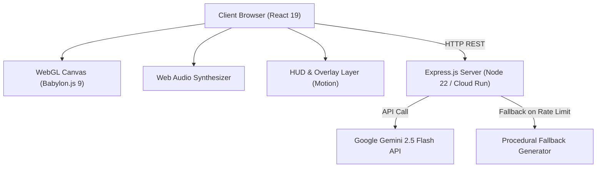

# Architecture & Technical Design

This document details the architectural design, rendering pipelines, physics simulation models, state machines, and server architecture of the **curtis.click Portfolio**.

---

## 1. High-Level Architecture Overview

---

## 2. Frontend Subsystems

### 2.1 React 19 UI & Navigation Layer
- **`src/App.tsx`**: Central application state manager. Tracks scroll progress through 6 stages (`SINGULARITY`, `SELECTED WORKS`, `AI ENGINEERING`, `AUTONOMY`, `ALIGNMENT`, `SYNTHESIS`), autopilot mode, interstellar sandbox mode, active target locks, and global hotkeys (`[A]`, `[W]`, `[N]`, `[P]`).
- **`src/components/InterstellarHUD.tsx`**: Futuristic telemetry overlay displaying system coordinates, orbital metrics, spacetime curvature indicators, and active celestial body metadata.
- **`src/components/ProjectHUD.tsx`**: Stage-based portfolio project cards with motion transitions.
- **`src/components/DebugInspectorCard.tsx`**: Interactive diagnostics drawer for particle velocity multipliers, layer visibility toggles, and runtime telemetry.

### 2.2 3D Astrophysics & Rendering Engine (`src/components/ParticleCanvas/`)
- **`SceneSetup.ts`**: Initializes Babylon.js `Engine`, `Scene`, `TargetCamera`, and default rendering pipeline (Bloom, Tone Mapping, Chromatic Aberration).
- **`CelestialMeshSynchronizer.ts`**: Synchronizes simulated 2D/3D `CelestialEntity` objects with Babylon.js mesh instances (PBR materials, Fresnel glow layers, dynamic lighting, rings).
- **`RenderEngine.ts`**: Main animation loop executing 60 FPS delta-time physics updates, camera shake dampening, slingshot probe updates, and particle velocity fields.
- **`PhysicsUtils.ts` & `CollisionEngine.ts`**:
  - Conservation of Momentum & Energy elastic/inelastic collision solver with overlap resolution.
  - Procedural Value Noise and Fractional Brownian Motion (fBm) 2D/3D noise algorithms.
  - Zero-divergence Curl Noise vector fields for natural fluid interstellar gas motion.
  - Hex color normalization and blending with shorthand 3-digit hex code expansion.
- **`SlingshotEngine.ts`**: Solves Runge-Kutta / Euler n-body gravitational trajectory forecasts for interactive probe launches.
- **`TidalDisruptionEngine.ts` & `TidalDisruptionFX.ts`**: Roche-limit calculation where stars entering a black hole's tidal radius are shredded into accretion streams and relativistic relativistic plasma jets.

### 2.3 Post-Processing GLSL Shaders
- **`BlackholeLensingPostProcess.ts`**: General relativistic deflection shader warping background space into Einstein rings around Kerr singularities.
- **`DepthOfFieldPostProcess.ts`**: Bokeh depth-of-field post-processing focusing on active target entities.
- **`FrameShatterPostProcess.ts`**: 13x13 Voronoi crystalline shatter shader triggered by stellar core collapse events.

---

## 3. Server Architecture (`server.ts`)

- **Dual-Mode Serving**:
  - **Development (`NODE_ENV !== 'production'`)**: Dynamically mounts Vite middleware with live reload.
  - **Production (`NODE_ENV === 'production'`)**: Serves pre-compiled production bundles from `dist/` with single-page app (SPA) HTML fallback.
- **Gemini Cosmic System Generation**:
  - Lazily initializes `@google/genai` client using `GEMINI_API_KEY`.
  - Configurable model via `GEMINI_MODEL` (defaults to `gemini-2.5-flash`).
  - Automatic fallback to `getProceduralFallbackSystem()` on network errors or rate limits (`429`).
- **Container Health Probes**:
  - `GET /health` and `GET /api/health` return service status, ISO timestamp, and process uptime.
  - Dedicated `ALL /api/*` 404 handler prevents missing API routes from inadvertently returning HTML.
- **Graceful Shutdown**:
  - Handles `SIGTERM` and `SIGINT` signals with a 10-second drain timeout for zero-downtime rolling deployments on Cloud Run and Kubernetes.

---

## 4. Verification & Testing (`scripts/test-integrity.ts`)

The project includes an automated test suite verifying:
1. **Hex Color Utilities**: 6-digit hex preservation, 3-digit shorthand expansion (`#fff` -> `#ffffff`), and NaN-free blending.
2. **Physics & Noise Calculations**: `valueNoise2D` bounds, `fBmNoise2D` octave aggregation, `computeCurlNoise` vector output, and `resolveCelestialCollision` momentum conservation.
3. **Cosmic Generator Contracts**: Entity counts, valid archetypes, positive radii, and required tags.
4. **Server Integration**: Ephemeral port binding, `/health` response verification, procedural fallback upon API invocation, and 404 routing.
