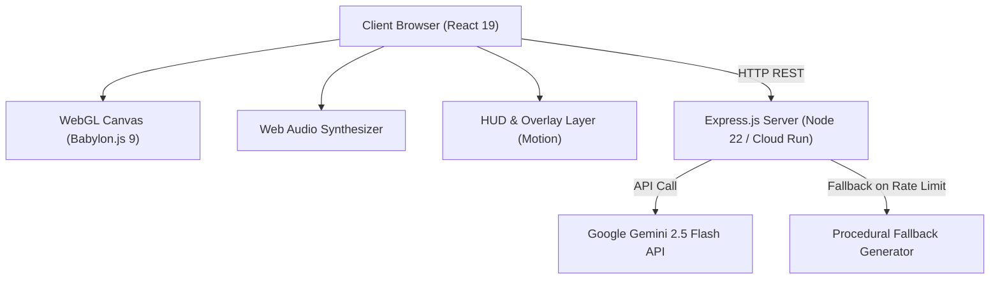

# Architecture & Technical Design

This document details the architectural design, rendering pipelines, physics simulation models, state machines, and server architecture of the **curtis.click Portfolio**.

---

## 1. High-Level Architecture Overview

---

## 2. Frontend Subsystems

### 2.1 React 19 UI & Navigation Layer
- **[`src/App.tsx`](file:///home/corp/curtis-click-portfolio/src/App.tsx)**: Central application state manager. Tracks scroll progress through 6 stages (`SINGULARITY`, `SELECTED WORKS`, `AI ENGINEERING`, `AUTONOMY`, `ALIGNMENT`, `SYNTHESIS`), autopilot mode, interstellar sandbox mode, active target locks, and global hotkeys (`[A]`, `[W]`, `[N]`, `[P]`, `[T]`).
- **[`src/components/InterstellarHUD.tsx`](file:///home/corp/curtis-click-portfolio/src/components/InterstellarHUD.tsx)**: Futuristic telemetry overlay displaying system coordinates, orbital metrics, spacetime curvature indicators, and active celestial body metadata.
- **[`src/components/ProjectHUD.tsx`](file:///home/corp/curtis-click-portfolio/src/components/ProjectHUD.tsx)**: Stage-based portfolio project cards with motion transitions.
- **[`src/components/DebugInspectorCard.tsx`](file:///home/corp/curtis-click-portfolio/src/components/DebugInspectorCard.tsx)**: Interactive diagnostics drawer for particle velocity multipliers, layer visibility toggles, and runtime telemetry.

### 2.2 3D Astrophysics & Rendering Engine ([`src/components/ParticleCanvas/`](file:///home/corp/curtis-click-portfolio/src/components/ParticleCanvas/))
- **[`SceneSetup.ts`](file:///home/corp/curtis-click-portfolio/src/components/ParticleCanvas/SceneSetup.ts)**: Initializes Babylon.js `Engine`, `Scene`, `TargetCamera`, and default rendering pipeline (Bloom, Tone Mapping, Chromatic Aberration).
- **[`CelestialMeshSynchronizer.ts`](file:///home/corp/curtis-click-portfolio/src/components/ParticleCanvas/CelestialMeshSynchronizer.ts)**: Synchronizes simulated 2D/3D `CelestialEntity` objects with Babylon.js mesh instances (PBR materials, Fresnel glow layers, dynamic lighting, rings).
- **[`RenderEngine.ts`](file:///home/corp/curtis-click-portfolio/src/components/ParticleCanvas/RenderEngine.ts)**: Main animation loop executing 60 FPS delta-time physics updates, camera shake dampening, slingshot probe updates, and particle velocity fields.
- **[`PhysicsUtils.ts`](file:///home/corp/curtis-click-portfolio/src/components/ParticleCanvas/PhysicsUtils.ts) & [`CollisionEngine.ts`](file:///home/corp/curtis-click-portfolio/src/components/ParticleCanvas/CollisionEngine.ts)**:
  - Conservation of Momentum & Energy elastic/inelastic collision solver with overlap resolution.
  - Procedural Value Noise and Fractional Brownian Motion (fBm) 2D/3D noise algorithms.
  - Zero-divergence Curl Noise vector fields for natural fluid interstellar gas motion.
  - Hex color normalization and blending with shorthand 3-digit hex code expansion.
- **[`SlingshotEngine.ts`](file:///home/corp/curtis-click-portfolio/src/components/ParticleCanvas/SlingshotEngine.ts)**:
  - Solves Runge-Kutta / Euler n-body gravitational trajectory forecasts for interactive probe launches.
  - Deterministic forward trajectory calculation eliminating aim preview depth-jitter.
  - Event horizon capture detection (`isHorizonBound`) and sub-lightspeed ceiling (55.0).
- **[`TidalDisruptionEngine.ts`](file:///home/corp/curtis-click-portfolio/src/components/ParticleCanvas/TidalDisruptionEngine.ts) & [`TidalDisruptionFX.ts`](file:///home/corp/curtis-click-portfolio/src/components/ParticleCanvas/TidalDisruptionFX.ts)**:
  - Multi-phase state machine: `IDLE` -> `STAR_APPROACH` -> `ROCHE_RUPTURE` -> `ACCRETION_SURGE` -> `GRB_DETONATION` -> `COOLDOWN`.
  - Roche-limit calculation where stars entering a black hole's tidal radius are shredded into accretion streams and relativistic relativistic plasma jets.
- **[`ParticleCanvas.tsx`](file:///home/corp/curtis-click-portfolio/src/components/ParticleCanvas.tsx) Resource Lifecycle Management**:
  - Enforces strict teardown order upon component unmount:
    1. Clear active timeouts and interval timers.
    2. Detach event listeners and remove pointer observers.
    3. Dispose active post-processes (`lensingPostProcessRef`, `wormholePostProcessRef`, `dofPostProcessRef`, `shatterPostProcessRef`, `activeTdeFxRef`).
    4. Dispose rendering pipeline (`composerRef`).
    5. Dispose the Babylon scene (`sceneRef`).
    6. Stop render loop and dispose the Babylon Engine (`rendererRef`) last.
    7. Clean up all attached global window properties.

### 2.3 Post-Processing GLSL Shaders
- **[`BlackholeLensingPostProcess.ts`](file:///home/corp/curtis-click-portfolio/src/components/ParticleCanvas/BlackholeLensingPostProcess.ts)**: General relativistic deflection shader warping background space into Einstein rings around Kerr singularities.
- **[`DepthOfFieldPostProcess.ts`](file:///home/corp/curtis-click-portfolio/src/components/ParticleCanvas/DepthOfFieldPostProcess.ts)**: Bokeh depth-of-field post-processing focusing on active target entities.
- **[`FrameShatterPostProcess.ts`](file:///home/corp/curtis-click-portfolio/src/components/ParticleCanvas/FrameShatterPostProcess.ts)**: 13x13 Voronoi crystalline shatter shader triggered by stellar core collapse events.

---

## 3. Server Architecture ([`server.ts`](file:///home/corp/curtis-click-portfolio/server.ts))

- **Dual-Mode Serving**:
  - **Development (`NODE_ENV !== 'production'`)**: Dynamically mounts Vite middleware with live reload.
  - **Production (`NODE_ENV === 'production'`)**: Serves pre-compiled production bundles from `dist/` with single-page app (SPA) HTML fallback.
- **Gemini Cosmic System Generation**:
  - Lazily initializes `@google/genai` client using `GEMINI_API_KEY`.
  - Configurable model via `GEMINI_MODEL` (defaults to `gemini-2.5-flash`).
  - Automatic fallback to `getProceduralFallbackSystem()` on network errors or rate limits (`429`).
- **Container Health Probes**:
  - `GET /health` and `GET /api/health` return service status, ISO timestamp, and process uptime.
  - Dedicated `ALL /api/*` 404 handler prevents missing API routes from inadvertently returning HTML.
- **Port Conflict Handling (`EADDRINUSE`)**:
  - Handles occupied ports gracefully with clear diagnostic output recommending port override via `PORT=<port>`.
- **Graceful Shutdown**:
  - Handles `SIGTERM` and `SIGINT` signals with a 10-second drain timeout for zero-downtime rolling deployments on Cloud Run and Kubernetes.

---

## 4. Verification & Testing ([`scripts/test-integrity.ts`](file:///home/corp/curtis-click-portfolio/scripts/test-integrity.ts))

The project includes an automated 19-test integrity test suite verifying:
1. **Hex Color Utilities**: 6-digit hex preservation, 3-digit shorthand expansion (`#fff` -> `#ffffff`), and NaN-free blending.
2. **Physics & Noise Calculations**: `valueNoise2D` bounds, `fBmNoise2D` octave aggregation, `computeCurlNoise` vector output, and `resolveCelestialCollision` momentum conservation.
3. **Cosmic Generator Contracts**: Entity counts, valid archetypes across 50 iterations, positive radii, and required tags.
4. **Astrophysics Mechanics**:
   - `createNeutronStarBirthEvent`: core collapse remnant mass safety and collapse semantics.
   - `calculateForwardTrajectory`: deterministic prediction, sub-lightspeed ceiling (55.0), and event horizon capture.
   - `TidalDisruptionEngine`: initial quiescent state, hyperbolic inbound trajectory trigger, and double-trigger prevention.
5. **Audio Engine Clean Teardown**: `audio.dispose()` timer and Web Audio context termination.
6. **Static Assets & Production Bundles**: `public/favicon.svg`, `index.html` metadata, `dist/server.cjs` bundle size, and `dist/index.html`.
7. **Server Integration & Fault Tolerance**: Ephemeral port binding, `/health` response verification, procedural fallback upon API invocation, 404 routing, and clean promise rejection on port conflict (`EADDRINUSE`).
